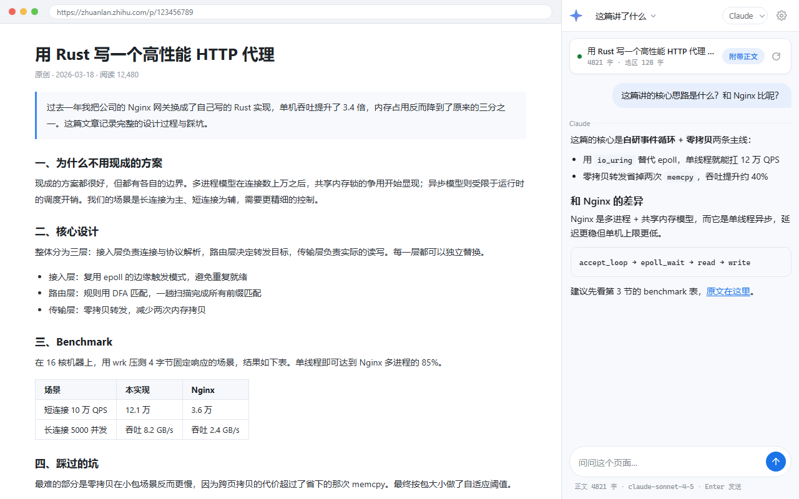

# Ask AI · 网页问答助手

> 让它读懂你正在看的网页，然后直接开口问。
> 一个 Chrome 侧边栏扩展（Manifest V3），**自带密钥（BYOK）**，无账号、无后端、无追踪。

[](LICENSE)




---

## 为什么做它

浏览器的内置 AI（比如 Chrome 里的 Gemini）受地区和账号限制，而且只能用它自己的模型。这个扩展把同样的交互方式变成**你自己的模型**：

- **自带密钥**：填你自己的 API Key，用哪家的模型、哪个中转站，完全由你决定
- **不收集数据**：没有后端、没有统计、没有广告 SDK，Key 和对话记录只存在你本机
- **按页面分会话**：打开新页面自动开新会话，同一页的追问留在同一会话

---

## 功能

**读页面**

- 自动抓取当前网页正文：优先 `article / main / [role=main]`，自动剔除导航、页脚、广告、评论区
- 顶部实时显示抓到多少字；页面上选中的文字会自动附在问题里
- 「附带正文」开关：也可以只发问题、不发正文

**会话**

- 打开新页面（URL 变化）自动开新会话；同一页面反复追问留在原会话
- 顶栏一键新建独立会话；下拉里可切回任意历史会话
- 会话历史存本地，关掉侧边栏再打开还在

**回答**

- 流式输出，可随时点停；支持 Markdown（标题、列表、代码块、链接）
- 复制 / 重新生成
- 界面跟随系统深浅色

**供应商**（11 种 + 自定义）

OpenAI · Claude · Gemini · DeepSeek · Kimi(Moonshot) · 智谱 GLM · 通义千问 · OpenRouter · 硅基流动 · 本地 Ollama · 任何 OpenAI 兼容端点

**接口协议可手动指定**：OpenAI 格式 / Anthropic 格式 / Gemini 格式——方便对接只提供单一协议的中转站。

---

## 安装（自由加载，无需商店）

1. 下载或克隆本仓库
2. 打开 `chrome://extensions`
3. 右上角开启 **开发者模式**
4. 点 **加载已解压的扩展程序**，选择**仓库根目录**（就是有 `manifest.json` 的那一层）
5. 点工具栏图标打开侧边栏 → 右上角齿轮填 API Key

> 需要 Chrome 114+（侧边栏 API）。Edge、Opera、Brave 等 Chromium 内核浏览器同样可用。

也可以直接下载发布包自己解压后加载：`python tools/pack.py` 会在 `dist/` 生成 zip。

---

## 配置

点侧边栏右上角齿轮：

| 项 | 说明 |
|---|---|
| AI 产品 | 选供应商，自动填默认 Base URL 与常用模型 |
| 接口协议 | 自动 / OpenAI / Anthropic / Gemini，手动指定以适配中转站 |
| API Key | 只保存在本机 `chrome.storage.local` |
| 模型 | 模型名会变，直接手填最稳 |
| Base URL | 自建 new-api / one-api / LM Studio 时填这里 |
| 正文长度上限 | 建议 8000–20000 字 |
| 温度 | 问答场景建议 0.2–0.5 |
| 打开新页面自动开新会话 | 关掉则所有页面共用一个会话 |

设置页有 **测试连接** 按钮，报错会直接给出 HTTP 状态和原因。

### Key 去哪拿

| 服务 | 地址 |
|---|---|
| OpenAI | <https://platform.openai.com/api-keys> |
| Claude | <https://console.anthropic.com/settings/keys> |
| Gemini | <https://aistudio.google.com/apikey> |
| DeepSeek | <https://platform.deepseek.com/api_keys> |
| Kimi | <https://platform.moonshot.cn/console/api-keys> |
| 智谱 | <https://open.bigmodel.cn/usercenter/apikeys> |
| 通义 | <https://bailian.console.aliyun.com/> |
| OpenRouter | <https://openrouter.ai/keys> |
| 硅基流动 | <https://cloud.siliconflow.cn/account/ak> |
| Ollama | 本地运行，无需 Key |

> ⚠️ **ChatGPT Plus / Claude Pro 等网页订阅不能直接用**：它们不含 API 访问权限。本扩展走各家官方 API，额度单独计费。想要一个 Key 用多家模型就用 OpenRouter，想完全离线就用本地 Ollama。

---

## 隐私

- 本扩展**不收集、不上传、不出售任何数据**，也没有分析/广告/遥测 SDK，没有自有服务器
- API Key、设置、会话历史只存在本机浏览器存储
- 只有你**主动点击发送**时，页面正文 + 你的提问才会发往**你自己配置的** AI 服务商
- 不读取浏览历史、Cookie、书签、已保存密码、下载记录

完整说明见 [PRIVACY.md](PRIVACY.md) / [docs/privacy.html](docs/privacy.html)。

---

## 目录结构

```
ask-ai/
├─ manifest.json        扩展清单（MV3）
├─ background.js        侧边栏打开行为
├─ providers.js         供应商定义 + 三种协议请求构造 + SSE 解析
├─ sidepanel.html/.css/.js   侧边栏（会话管理 / 读页面 / 流式对话 / Markdown）
├─ options.html/.css/.js     设置页
├─ icons/               图标
├─ tools/
│  ├─ validate.mjs      自检脚本（node tools/validate.mjs）
│  ├─ pack.py           打包 zip
│  ├─ make_icons.py     生成图标（需 Pillow）
│  └─ store-shots.py    生成商店展示图（需本机 Chrome）
├─ docs/                隐私政策、商店文案、展示图
└─ .github/workflows/   CI：自检 + 打包
```

---

## 开发

```bash
git clone <repo>
cd ask-ai

node tools/validate.mjs     # 自检：manifest / 协议构造 / DOM 引用 / 会话逻辑 / Markdown / 卫生检查
python tools/pack.py        # 打包 → dist/*.zip
python tools/make_icons.py  # 重新生成图标（需要 pillow）
```

改完代码后，在 `chrome://extensions` 点扩展卡片的「刷新」即可生效。

贡献指南见 [CONTRIBUTING.md](CONTRIBUTING.md)。改动较大时请同步更新 `docs/privacy.html` 与商店文案。

---

## English quick start

1. `chrome://extensions` → enable **Developer mode** → **Load unpacked** → pick the repo root (the folder containing `manifest.json`)
2. Click the toolbar icon to open the side panel → gear icon → paste **your own API key** (OpenAI / Claude / Gemini / DeepSeek / Kimi / GLM / Qwen / OpenRouter / SiliconFlow / local Ollama / any OpenAI-compatible endpoint)
3. Open any article and ask about it

The extension ships **no backend of its own** and collects nothing. Your key and chat history stay in your browser's local storage; page text and questions are sent only to the AI provider you configured, and only when you press send.

Request format can be set manually to **OpenAI**, **Anthropic** or **Gemini** style for relay services that expose just one protocol.

---

## 免责声明

本项目为个人开源项目，与 OpenAI、Anthropic、Google、Meta 等厂商无任何隶属或合作关系。各家 API 的使用条款与计费以其官方说明为准。使用本扩展产生的任何费用与后果由使用者自行承担。

## License

[MIT](LICENSE) — 自由使用、修改、再分发，保留版权声明即可。
